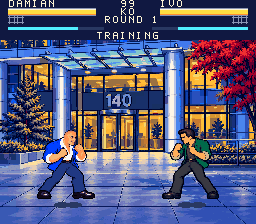

# Abaqus: After Hours

An original six-button fighting game for the **Super Nintendo**, inspired by the arcade structure of Street Fighter II and the people and places of Abaqus in Santiago.

**v0.10.0 current packaged technical snapshot; human review pending.** The
candidate is source-frozen at commit
`8536bb6956212952c17302a62cc6c1de7e12a65d`, tree
`d524d3f960600dc5c9ff83578ac73675f9798735`; its ROM is SHA256
`a8f7b797a06bd242a18bf54400e53f043d5a84f274765ba3a34f9d8289ac5445`, header
checksum `BE19`. Native PPU review accepted all three stage scenes and the
arena picker, and focused presentation, stage and menu probes pass. Fresh
committed export validation passes 214 assets and symbols in 62.031 seconds.
`Test.cmd` exits 0 with all six reports matching this SHA: 2,595 gameplay,
18,081 roster, 1,756 presentation, 1,020 focused-input, 8,131 stage and 622
Training checks (32,205 total). The [stage pass note](docs/STAGE-CARTOON-v2.md)
and [preservation report](docs/cartoon-preservation-report.json) document the
candidate evidence. The current work introduces stronger early-1990s
arcade-cartoon stage art for Las Condes, El
Castillo and La Oficina. The three versioned masters are
`00-las-condes-cartoon-v2.png`, `01-castillo-cartoon-v2.png` and
`02-oficina-cartoon-v2.png`, each with adjacent exact-basename provenance JSON
and raw source under `assets/art/stages/source-v2/`. The selected stage manifest
uses schema 2 and retains `stages-v0.4.json` as history. `tools/stage_sources.py`
validates the source contracts and `tools/stage_cartoon.py` adapts the existing
feature-driven ambient work to the new palette/map. The candidate keeps the
four-phase ambient-cell and `TRACE[115..118]` budgets and includes bounded
menu-only correctness polish: cleaned directional edges, both-pad navigation
only for the P2 roster case, Start > B > A priority and immediate return after
Back. Active combat, Fighter/Wave ABI, fighters, portraits and audio are
unchanged. Ambient change counts by phase are Las Condes `[0,20,20,20]`,
El Castillo `[0,18,18,18]` and La Oficina `[0,6,6,6]`; the office keeps one
3-pixel monitor segment per monitor at `y114` while protecting the digits.
The preservation report records 192 generated files retained from v0.9,
including all fighter 64-frame banks, palettes, portraits, UI, audio, title and
select assets. Endurance passes all three modes at 216,356 live frames each at
60.098811862348406 FPS, with wraps 4/4/3, peak SPC backlog 6 and empty
cadence, native-timing, ambient, PPU-overflow and SPC-FIFO failure arrays. The
technical audio report passes 1,262/1,262 capture-only checks: all four cues
and four scores are unclipped, four music captures run 60.899688-63.079432
seconds, and no near-zero interval reaches 0.5 seconds (longest near-silence
0.075499-0.078652 seconds). The separate listening pack is 15,447,456 bytes,
SHA256 `5afec27e3022f87580e21991beb6785b9366dfb9bf16bf2abb45a08400309c70`.
The 288-by-600 matchup/stage/policy/replay/symmetry run with four replays
across all three stages, pinned bsnes smoke at 600/600 plus the independent
28,800-frame run, and `validate_release_evidence` all pass on this SHA.
The current [v0.10.0 Windows package](dist/Abaqus-After-Hours-v0.10.0-Windows.zip)
is available and `tools/audit_release.py` passes 7,472 checks against it.
Two final packaging runs produce identical 6,592,864-byte archives, SHA256
`8402f8be6f4c928e5b56cf22955d990c8bb6c4e2107262d489d2b3fc84036a99`.
Human listening, gameplay, controller, likeness/consent and public-use review
remain open, and `public_release_certified` remains false.

**v0.9.0 packaged technical snapshot (historical).** A live review of the v0.8.1
snapshot found clipped selection faces, a Damian likeness mismatch, a weak
arena-picker composition, and stage pixels showing through HUD and result
lettering. The historical v0.9.0 pass contains presentation corrections for
those four findings. It recorded its candidate manifest as ROM SHA256
`bce460fbaa6f63e2f9c614f5c6833c08fd70558d56e7a27adfad292d4d200639`, header
checksum `6D41`. The corrected v0.9.0 source freeze is commit
`76f0a08a7562800df01507db83c6877745c3bdcf`, tree
`f37852da57a42d2d6819374db5d23278d12587a5`. All six native reports pass on
this SHA: 2,595 gameplay, 18,081 roster, 1,756 presentation, 997 focused-input,
8,131 stage and 622 Training checks (32,182 total). The 288-by-600 native
matchup/stage/policy/replay/symmetry evidence, pinned bsnes smoke plus bounded
48-by-600 run, endurance of 216,356 live frames in each of three modes, fresh
214-asset export in
75.078 seconds and `validate_release_evidence` also pass on this SHA;
`Test.cmd` exits 0. The historical [v0.9.0 Windows package](dist/Abaqus-After-Hours-v0.9.0-Windows.zip)
is available and `tools/audit_release.py` passes 7,471 checks against it. `public_release_certified` remains false.

Two consecutive packaging runs produce identical **6,578,152-byte** ZIPs,
SHA256 `8203ffab8d27b4205e25ebfcc2e74e09f5af199641b281a925a9b981c4d1f97e`.

**Previous technical snapshot: v0.8.1 (historical).** The native
source targets a 4 MiB NTSC FastROM LoROM cartridge across 128 banks, compiled
from C and 65816 assembly. The source freeze is commit
`fe05e5fd1391a1db20f1b66f1e9f6e699445e77a`, tree
`46e1af160ffb8ab6cb768e3d9deec1352d77ae83`. That historical ROM had SHA256
`76b456d1ac75471a8b9710c61b0ce4c6ab9ca344b1b8a1f17e38f36e52904466`, header
checksum `A358`; the historical manifest recorded the
identity. Native C/ASM, controls, gameplay and audio are unchanged.

The historical v0.8.1 `Test.cmd` run exits 0 with all six reports on that SHA: 2,595 gameplay, 18,081
roster, 215 presentation, 997 focused-input, 8,131 stage and 622 Training
checks (30,641 total). Fresh committed export validation reproduces the ROM,
manifest, 214 assets and symbols in 76.344 seconds. The 288-by-600 native
matchup, all-three-stage, two-policy, four-replay and symmetry checks pass. The
pinned bsnes smoke matches this SHA with 600/600 cadence, healthy PPU/PCM and
ambient freeze; the bounded 48-by-600 run also passes. Native endurance passes
216,356 live frames in each of three modes at 60.0988118623 FPS, wraps 4/4/3,
peak SPC six, zero stable FIGHT lag and empty failure arrays.
`validate_release_evidence` passes. The historical v0.8.1 offline package
passes 7,471 technical audit checks; v0.8.0 remains historical evidence.
Reston's full64 native visual review accepts the v4 art for integration; see the
[Reston v4 likeness review](docs/RESTON-LIKENESS-v4.md). The user confirmed the
revised buzz cut looks closer; final team likeness/consent, balance, full listening,
controller and branding gates remain open. The user selected **emulators first**
for the first public release; original SNES/flash-cartridge support stays
unverified. The [review record](docs/review-feedback.json) records the live
presentation findings above and a brief audio preview heard with no issue
noticed; full combat, listening, controller, likeness/consent and branding
review remain open. `public_release_certified` remains false.

A supplemental historical [audio review](docs/AUDIO-REVIEW.md) provides matched native cue
captures and measured score repetition from the same ROM. Its listening ZIP
and PCM checks support human review; they do not establish listening approval
or replace the six canonical suites.

A supplemental historical [Mesen-S compatibility review](docs/MESEN-REVIEW.md)
checks the v0.8.1 frozen cartridge in a third engine, including pause guides,
Training, stage animation and bounded combat. It is separate from the pinned
Snes9x and bsnes release gates and does not establish v0.9.0 or v0.10.0
evidence or change the packaged game.

The [v0.6.0 development notes](docs/RELEASE-v0.6.0.md) describe the packaged
64-frame roster, air attacks, throws and recovery. The
[v0.5.1 notes](docs/RELEASE-v0.5.1.md) retain the previous baseline's evidence.
The [v0.6.1 development notes](docs/RELEASE-v0.6.1.md) describe the CPU and
crouch-guard corrections. That historical offline package passes 202 technical audit
checks; identical packaging inputs produce identical ZIP bytes.
Public-release gates remain open.

The v0.7.0 stage/effect integration is verified in the v0.7.0 baseline ROM. It adds
restrained code-native ambient motion to the three stages and original strike,
guard, high-wave and ground-wave effect phases while preserving the native
actor and interface budgets. The v0.7 offline package passes 214 technical
audit checks and repeated packaging produces identical ZIP bytes. See the
[v0.7.0 development notes](docs/RELEASE-v0.7.0.md).

The verified v0.8.0 snapshot adds a three-page pause overlay: Normal, Controls
and Specials. Select cycles pages and Left/Right toggles guide pages. Start
resumes first; otherwise B returns to the roster, A resumes and Select cycles
pages. The live guide names
both fighters, their special names and family types, and shows the true
12-tick quarter-circle motion and 32-energy cost. Training pause Up/Down cycles
Stand, Guard High, Guard Low and Jump; guard holds relative back without
retreat, and the Jump dummy automatically jumps again after landing. Live
Select resets the round while preserving the dummy choice. Pause camera shake freezes and a paused
contact settles the actual HP bar on the first quiet paused tick.

The guide uses original opaque glyphs 256-383 in VRAM `$5000-$57FF` before the
BG2 map at `$5800`; the selected portrait remains at `$4A00`. Rows 5-27 publish
as a 1,472-byte panel over three paused ticks and yield to actor DMA. Stable
trace offsets `0..118` and all fighter assets remain unchanged; v0.8 appends
`TRACE[119]` pause page, `[120]` guide build stage, `[121]` Training dummy mode
and `[122]` guide dirty. The complete v0.7.1 snapshot remains documented below
as historical evidence; it is not a v0.8 verification claim.

The historical v0.8.1 snapshot keeps the v0.8.0 native pause, Training and menu behavior
unchanged. Its art-only revision replaces Reston's full 64-frame set and
portrait with the v4 short-buzz-cap sources, retaining the v3 sources and all
shared palette, scale and gameplay contracts. Native visual review accepted the
revision for integration; the later live presentation review found the four
defects recorded above. The historical v0.9.0 pass addresses them without
changing native combat, controls, audio or pause-guide contracts; its native
verification and package audit are recorded above. Pause and Training review captures: [Arcade controls](docs/screenshots/training/mode0-controls.png),
[Arcade specials](docs/screenshots/training/mode0-specials.png),
[Versus controls](docs/screenshots/training/mode1-controls.png),
[Versus specials](docs/screenshots/training/mode1-specials.png),
[Training controls](docs/screenshots/training/mode2-controls.png),
[Training specials](docs/screenshots/training/mode2-specials.png),
[Damian selected](docs/screenshots/training/special-page-00.png) and
[Lars selected](docs/screenshots/training/special-page-11.png).



## Play

On Windows, double-click **[Play.cmd](Play.cmd)**. The launcher downloads the official Snes9x 1.63 release into `.tools/` on its first run, verifies its SHA256, and opens the game. No administrator account or global installation is needed. The tools are already present in this checkout.

For offline Windows play, extract the historical v0.8.1 package
[Abaqus-After-Hours-v0.8.1-Windows.zip](dist/Abaqus-After-Hours-v0.8.1-Windows.zip)
and launch its `Play.cmd`. It includes the exact historical verified cartridge, Snes9x,
player manual, licenses and QA reports, and passes 7,471 technical audit checks.
Two consecutive runs produce identical 6,546,645-byte archives, SHA256
`04d951c3abef278afada5a666f9eec8a04d140650354bd82506e750e2849e0b6`.
The [archive checksum](dist/release-sha256.txt) identifies this build.
The v0.8.0 package remains a historical archive; its prior checksum and size
are recorded in the historical evidence below.

Historical v0.8.0 packaging produced a 6,546,551-byte ZIP with SHA256
`44f92c041563badc1a6b903e859ad4dd5258b5bd85f6d253cdf74b5c06641869`.

On other platforms, open **[dist/abaqus-after-hours.sfc](dist/abaqus-after-hours.sfc)** in a SNES emulator. No BIOS or commercial ROM is required.

With the included keyboard configuration:

| Action | Player 1 |
| --- | --- |
| Move / jump / crouch | Arrow keys |
| Light / medium / heavy punch | A / S / D |
| Light / medium / heavy kick | Z / X / C |
| Confirm a menu choice | X or Enter |
| Back from a menu | Z |
| Pause | Enter |
| Pause guide / Training dummy | Shift / Q while paused |
| Character special | Down, toward, then A or S |
| Rising uppercut | Down + D |
| Throw | Toward opponent + D, at close range |

See the [player guide](docs/PLAYER-GUIDE.md) for SNES button mappings, player two,
pause guide pages, Training dummy modes, buffered motion inputs, blocking and
combos. Controllers can be mapped in Snes9x under **Input -> Input Configuration**.

## Included

- All 12 requested fighters, with individual illustrated identities, costumes and legacy key poses. The v0.8.0 baseline pins all prior 64-frame banks; the historical v0.8.1 snapshot updates only Reston's complete set and portrait to the v4 short-buzz-cap art, with the v3 sources retained.
- Sixty-four uniform 96x80 native frames per fighter: legacy frames 0-15, motion and transition frames 16-31, action frames 32-47, and airborne/throw/knockdown frames 48-63. Twelve new airborne atlases supply dedicated air punch and air kick anticipation, active and recovery drawings plus throw and wake art; each keeps its `animation-airborne.json` prompt and provenance.
- Las Condes, El Castillo and La Oficina, illustrated as original pixel-art stages from the supplied location references.
- The v0.10.0 stage candidate refreshes all three arenas with one consistent
  early-1990s bold-navy cel-cartoon treatment. The same complete stage art is
  used in each arena thumbnail; source and manifest provenance are described
  in the candidate section above. Native PPU review accepted all three scenes
  and the arena picker, with focused stage probes passing. All six current
  native reports now match the frozen SHA; the extended technical evidence and
  `validate_release_evidence` also pass, while human stage review remains open.
- Arcade Shift: fight the other 11 coworkers across the three locations and become Office Champion.
- Local Versus: two controllers, independent input, best-of-three matches and rematches.
- Training: a configurable practice opponent, gated automatic health recovery, unlimited time and a Select quick reset that clears active throw/knockdown state.
- v0.8.0 pause help: Normal, Controls and Specials pages with live fighter names,
  special names and family types. Training pause Up/Down selects Stand, Guard
  High, Guard Low or Jump, and Select resets live Training without losing the
  selected dummy mode.
- A clean royal-navy, white and gold home/select/arena presentation with one cursor, the same four-by-three roster grid and a large selected portrait. The selection screen keeps the focus on the fighter instead of a statistics panel. The historical v0.9.0 presentation pass uses contained selection portraits, gives the arena picker complete aspect-contained thumbnails with a separate label column, and uses opaque panel glyphs for HUD/result lettering. Its packaged Windows archive and 7,471-check audit are available.
- Six normal attacks, dedicated air punch/kick transitions, crouching attacks, high/low blocking, throws with delayed impact damage and simultaneous throw tech, a universal uppercut and confirmed normal/special cancels.
- Twelve tuned specials across four families: projectile, advancing rush, low shockwave and rising strike. [Character profiles](docs/CHARACTERS.md) explain the roster and move families.
- Health, regenerating energy, round counters, timer, hitstop, impact effects, camera shake, pause, four original tracker music arrangements and four resident SPC combat effects using the same synthesized cues.
- v0.7.0 integration work for four-phase stage ambient motion and original
  combat-effect cells. The source stage masters and palettes remain unchanged;
  the verified v0.7.0 baseline ROM and native/compatibility reports verify this milestone.
- v0.7.1 source-freeze CPU opening, active-wave guard and staged impact/reset
  feedback remain historical behavior. The v0.8.0 pause/help integration is
  verified in the historical six-report baseline and unchanged in the historical
  v0.8.1 snapshot.

The renderer keeps the 96x80 canvas, 94x77 safe area, native baseline 78 and
one physical scale per fighter across all 64 frames. The legacy 48 frame
pixels and shared fifteen-color OBJ palette are locked; the new airborne range
is normalized at the established scale. Each fighter's data is encoded into
eight 30,720-byte LoROM-safe banks (`fighterXX` through `fighterXXh`) and the
native review strip is 6,144x80 RGBA. Distinct lift, flight, floor, get-up and
wake states, four wake-invulnerability ticks and a final six-tick wake input
buffer are part of the v0.6 source integration. More human balance review,
stage parallax and hardware verification remain on the [polish roadmap](docs/ROADMAP.md).

## Build and verify

Windows x64:

```powershell
.\Build.cmd
.\Test.cmd
```

`Build.cmd` bootstraps pinned project-local tools, then builds from the committed hardware-ready assets. To regenerate all graphics and music:

```powershell
.\Build.cmd --assets
```

The historical v0.7.1 `Test.cmd` batch ran five native suites silently and
headlessly in the official Snes9x libretro core: gameplay, roster, presentation,
focused input and stage dynamics. They send controller input and read
WRAM/VRAM, rendered frames and captured audio without playing it. Each report
records the exact tested ROM hash. Its canonical batch passed against the
v0.7.1 source-freeze image; the separate pinned compatibility smoke matched
that SHA and ran outside the five-suite `Test.cmd` batch:

- `docs/test-report.json`
- `docs/character-test-report.json`
- `docs/presentation-test-report.json`
- `docs/input-test-report.json`
- `docs/compatibility-test-report.json`
- `docs/stage-test-report.json`
- `docs/training-test-report.json` (v0.8.1 verified Training suite)

The [manifest](dist/manifest.json) includes the ROM SHA256 and header checksum.
The historical v0.7.1 snapshot had all five native reports passing against
`64dca043c8407659d05a22cc68b36d589d96bf4785fa630297d4e1526ed56022`: 2,595
gameplay, 18,085 roster, 215 presentation, 999 focused-input and 8,143 stage
checks, or 30,037 total. Thirty mirrored both-pad pause/cadence regressions and
bounded `clearFightHint`/`fillPausePanel` coverage are included. The native
batch covers both boot phases, two-controller air/trades/combo cadence,
resident-audio probes, CPU coverage across three difficulties and four special
families for 600 live ticks each (7,200 total), and the full 288-case x 600-frame
run plus four replays. The input suite also covers near-special, far-negative,
29-46 approach, low-guard and wake cases with strict no-KO lookahead. Native
screenshots and animation review captures are retained under
`docs/screenshots/`.

The historical pinned bsnes2014 Accuracy report passes against the same v0.7.1
SHA with title/select/arena/fight captures, controller movement and jump, all
three stages across four actual PPU ambient phases with freeze checks,
synchronized low-wave combat, 600 one-tick cadence frames and captured audio.
The synchronized low-wave probe observed 37 two-wave frames in 600, all 600
cadence deltas were one, and `STAT77` stayed at `0x01` with overflow bits
`0xC0` clear.
Its static stage plates match all 15,360-15,616 sampled pixels within eight
channel levels (maximum delta 7). It is an independent smoke only; it does not
replace full combat, soak or human verification. Run it with PowerShell
`tools/setup-compat.ps1` followed by `python tools/test_compatibility.py`.

The earlier four-family 600-frame probe remains historical v0.7.0 evidence. The
verified v0.8.0 snapshot added `tools/test_training.py` as the sixth required
`Test.cmd` suite. The historical v0.8.1 reports pass on the exact SHA with 30,641
checks: 2,595 gameplay, 18,081 roster, 215 presentation, 997 focused-input,
8,131 stage and 622 Training. Matching compatibility, matchup, bounded
independent-combat, live-hour, replay, symmetry and fresh-source evidence also
pass. The historical v0.8.1 package and archive audit pass 7,471 technical
checks. The historical v0.9.0 reports on the corrected SHA pass 32,182 native
checks; the matching extended evidence and `validate_release_evidence` pass as
described above. The historical [v0.9.0 Windows package](dist/Abaqus-After-Hours-v0.9.0-Windows.zip)
is historical evidence and its archive audit passes 7,471 checks. The frozen
v0.10.0 candidate has all six reports matching its SHA (32,205 checks), plus
focused presentation, stage and menu probes and native PPU review recorded
  above. Endurance and technical audio capture pass as documented above; the
  matchup, pinned bsnes/independent compatibility evidence and
  `validate_release_evidence` also pass. Human listening, controller,
  likeness/consent and public-use review remain open. The current
  [v0.10.0 Windows package](dist/Abaqus-After-Hours-v0.10.0-Windows.zip) is
  available and its archive audit passes 7,472 checks; `public_release_certified`
  remains false.
The training host enables `snes9x_up_down_allowed` so same-pad and cross-pad
SOCD cases reach the native cleaner; the offline `Controls::AllowLeftRight`
preference is not changed for existing users.

The historical v0.7.1 QA paths were bounded and silent: `python tools/test_matchups.py`
runs the ordered 12-by-12 local-versus matrix across all three stages;
`python tools/test_endurance.py --benchmark` precedes the uninterrupted
per-mode hour gate run with `python tools/test_endurance.py`; and
`python tools/test_fresh_build.py` rebuilds a committed source export with
freshly extracted pinned tools. Its fresh export validation passed in 63.25 seconds
with exact ROM/manifest and 214 asset/symbol matches. The full native endurance
passes 216,356 live frames in each of three modes at 60.098811862 FPS, with one
boot/unload, zero reboots, wraps 4/4/3, all coverage true, empty failure arrays,
stable FIGHT lag 0, healthy video/PCM and SPC maximum six drained. The
accelerated run took 164.968 seconds; `validate_release_evidence` passed for
that historical snapshot.

The v0.6 native fast path caches actor-bank and per-action timing selection,
uses compile-checked `Fighter` stride 64 and `Wave` stride 16 layouts, and
caches unchanged OAM/shadow work by integer position and facing. Health and
energy bars retain their native glyph formulas. Impact HUD and empty-banner
clears continue through hitstop ticks, while interface DMA yields when an actor
frame is uploaded; the engine and VRAM contract stay unchanged. As a result,
interface impact feedback may settle one to three video frames after the combat
event while hitstop keeps the fight state frozen.

The historical v0.7.1 source freeze kept one resident ready-only FIFO record in `main`
for native work; there is no polling or streaming path, and SDK loading is
unchanged. The streamed API and nonzero `AllocateRegion` remain future stream
service prerequisites. `applyHitReaction` uses a 256-entry ROM lookup of
`12 + floor(final_u8_damage/3)` for every wrapped `u8` damage value and resets
reaction fields; `fillBannerPanel` writes exact 96-word rows 10-12. Native geometry/cache refreshes `refreshFighterOam`, OAM
uses packed XY words, and `queueFighter` preserves its four-byte pointer while
uploading 3,840 bytes. The source-freeze OAM audit passes 746 controller frames,
comparing the full 544 OAM bytes and geometry for each frame.

Real KO contact resolution keeps damage, winner selection, timers and layout
unchanged. `roundBannerPending` keeps the first frozen `roundEnd` tick quiet,
then transfers the panel, name and HUD on the second tick, avoiding a
contact-time stall.

The historical v0.8.1 snapshot keeps the same resident-audio and native transfer
contracts. Its manifest records the historical ROM SHA above; the historical v0.8.1 package
passes 7,471 technical audit checks. The v0.8.0 package is historical evidence.
The historical v0.8.1 snapshot changes the Reston art sources only and leaves those native
contracts unchanged.

Combat sound effects now load as four resident SPC slots alongside the music:
`effects.it` is soundbank module 0 and music modules remain IDs 1-4. Scene load
uses `spcLoadEffect0..3`; gameplay calls `spcEffect` at pitch 2 and 8 kHz with
the existing volumes and pan. Same-frame cues coalesce by priority—round,
impact, special, then swing—to avoid competing effect streams. This replaces
the streamed-BRR path that stalled under two simultaneous attack/impact cases.

## Project map

| Location | Purpose |
| --- | --- |
| `src/game.c` | Combat, input buffering, animation state, AI, menus, rounds and arcade progression |
| `src/characters.h` | Individual combat profiles and special families |
| `src/hardware.asm` | Native metasprite rendering, OAM and strided DMA |
| `src/trace.asm` | Direct read-only combat/ambient telemetry stores at `0..113`, `115..118` and pause-guide fields `119..122`; `main` samples PPU `STAT77` at `114` before DMA |
| `src/pause_guide.h` | Frozen pause Controls/Specials pages and Training dummy behavior |
| `src/animation_banks.h` | Eight-bank fighter frame lookup for the 64-frame contract |
| `assets/art/` | Original character masters, animation atlases, independent stage PNGs and menu art |
| `assets/generated/` | Reproducible SNES tiles, eight fighter banks, palettes, music and resident effect data |
| `tools/` | Bootstrap, encoding, build, stage/effect generation, emulator tests and packaging |
| `tools/test_matchups.py` | Bounded ordered local-versus matrix for technical matchup evidence |
| `tools/test_endurance.py` / `tools/longrun_host.py` | Silent uninterrupted hour/mode endurance gate and callback host |
| `tools/test_fresh_build.py` | Fresh pinned-tool extraction and committed-source rebuild gate |
| `tools/test_training.py` | Pause-guide, Training dummy and pause SOCD suite |
| `tools/portrait_assets.py` | Shared head-anchored, contained select/profile portrait framing |
| `tools/test_mesen.py` | Optional pinned Mesen-S third-engine scene, stage and bounded combat checks |
| `docs/PLAYTEST.md` | Human likeness, gameplay feel, controls, audio and branding review route |
| `dist/` | Playable ROM and release manifest |
| `docs/` | Controls, technical notes, animation contract, art prompts, credits, roadmap and QA evidence |

Git tracks the source, master art, generated cartridge assets and ROM. Downloaded toolchains and release ZIPs stay outside history. Prior releases are tagged `v0.1.0`, `v0.2.0`, `v0.3.0`, `v0.3.1`, `v0.4.0`, `v0.4.1`, `v0.5.0` and `v0.5.1`; `v0.6.0` records the animation baseline, `v0.6.1` the CPU update, and `v0.7.0` the verified stage/effect update and development package. v0.7.1 and v0.8.0 are historical; v0.8.1 is historical, v0.9.0 remains the historical packaged technical fallback, and v0.10.0 is the current packaged cartoon-stage technical snapshot with human review pending. No remote repository is configured by this project.

Team references: [Abaqus Solutions](https://abaqus.io/es/abaqus-solutions/team) and [Abaqus Wealth Care](https://abaqus.io/es/wealth-care/about-us). See [credits and asset provenance](docs/CREDITS.md), [art prompts](docs/ART-DIRECTION.md), and [technical notes](docs/DEVELOPMENT.md).
