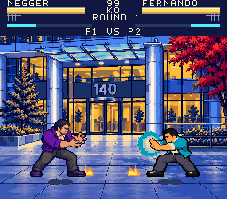

# Abaqus: After Hours
<!-- candidate-version: 0.23.1; rom-sha256: 057139801b64d1d486c91e18f456e01519dd4d25c3d0d6a92e61f311b99da3fd -->

An original four-button fighting game for the **Super Nintendo**, inspired by
Street Fighter II and the people and places of Abaqus in Santiago.
Twelve fighters, three illustrated stages and five original music scores,
running as a native SNES cartridge.

**Current version:** [v0.23.1](docs/RELEASE-v0.23.1.md) on `main`.

## Play

**Windows:** run **[Play.cmd](Play.cmd)**. On first launch it downloads and
prepares Snes9x locally. Press **Enter** to start; **Alt+Enter** toggles fullscreen.

**Other platforms:** open [dist/abaqus-after-hours.sfc](dist/abaqus-after-hours.sfc)
in a SNES emulator. Original SNES and flash-cartridge support remain unverified.

## Game modes

- **Arcade Shift:** fight all eleven coworkers, with personal exchanges and endings.
- **Local 1v1 / 2P:** choose two fighters and play a best-of-three match.
- **Training:** practice against a dummy or CPU with input history, combo damage
  and three drills.

Combat includes high/low blocking, throws, specials and a unique super for each
fighter. The pause menu includes controls and a move list.

## Controls

The four attack buttons are **Y/X for light/strong punches** and **B/A for
light/strong kicks**.

| Action | Player 1 keyboard | Player 2 keyboard |
| --- | --- | --- |
| Move / jump / crouch | Arrow keys | I / J / K / L (up / left / down / right) |
| Light / strong punch | A / S | Numpad 7 / 8 |
| Light / strong kick | Z / X | Numpad 1 / 2 |
| Start / pause | Enter | Space |
| Select / pause guide | Shift | Q |

In menus, **X or Enter** confirms and **Z** goes back for Player 1.
For a super, release directions and attack buttons, then press **Y+B** together
with full energy (**A+Z** on the P1 keyboard).

Enable **Num Lock** for P2. To use controllers, map each one to **Joypad 1** or
**Joypad 2** in Snes9x under **Input → Input Configuration**.

See the [player guide](docs/PLAYER-GUIDE.md) for specials, blocking, combos,
Training options and the complete controls.

## Build and test

Development uses Windows x64 and project-local **PVSnesLib 4.6.0**.

| Command | Purpose |
| --- | --- |
| `Build.cmd` | Prepare the toolchain and build the cartridge |
| `Build.cmd --assets` | Regenerate art/audio assets and rebuild |
| `Test.cmd` | Run the six native emulator suites silently and headlessly |

The output is `dist/abaqus-after-hours.sfc`. Downloaded tools and build
intermediates stay in ignored `.tools/` and `build/` directories.

## Documentation

- [Player guide](docs/PLAYER-GUIDE.md) — controls, modes and practice.
- [Current release](docs/RELEASE-v0.23.1.md) and [verification](docs/verification-v0.23.1.json).
- [Development guide](docs/DEVELOPMENT.md) — native architecture and hardware budgets.
- [Roadmap](docs/ROADMAP.md) — planned work and historical milestones.
- [Credits and art provenance](docs/CREDITS.md) · [License](LICENSE).

Older releases and detailed evidence remain under `docs/`.
