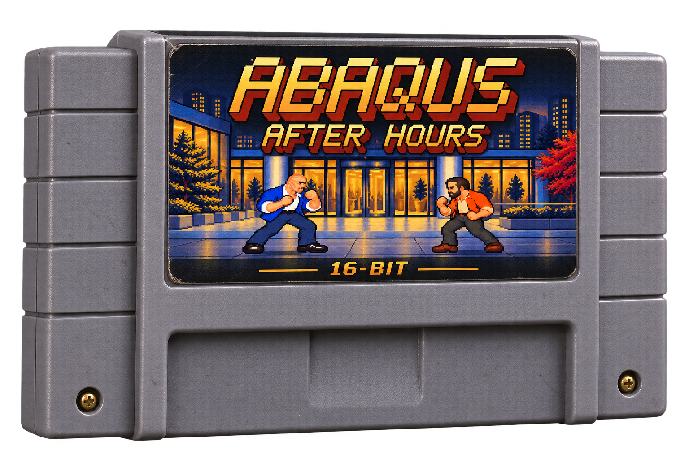

# Abaqus: After Hours
<!-- candidate-version: 0.33.0; identity: TECHNICALLY_VERIFIED_HUMAN_REVIEW_PENDING; rom-sha256: 64f7db0dea8b42be855abd836a8f7c9d2f249873a74116e4a0f06ee773631aad; source-freeze: fd4bee3acd8ef92d2437d1a9ead4125edb641a88 -->

An original four-button fighting game for the **Super Nintendo**, inspired by
Street Fighter II and the people and places of Abaqus in Santiago.
Twelve fighters, three lively stages, office bonus rounds and five original scores.

**[▶ Play in your browser](https://abaqus-after-hours.restonjd.workers.dev/)** — no download needed.

The game loads automatically. Choose your mode, fighters and arena; the fight
starts after its countdown. Your first key or tap enables sound. Arcade,
Training and local 1v1 use the same native SNES cartridge.

## Play locally

**Windows:** run **[Play.cmd](Play.cmd)**. On first launch it downloads and
prepares Snes9x locally. Press **Enter** to start; **Alt+Enter** toggles fullscreen.

**Other platforms:** open [dist/abaqus-after-hours.sfc](dist/abaqus-after-hours.sfc)
in a SNES emulator. Original SNES and flash-cartridge support remain unverified.

**Local browser player:** run [Web.cmd](Web.cmd).
[Cloudflare setup](docs/CLOUDFLARE.md) covers hosting your own copy.

## Game modes

- **Arcade:** fight all eleven coworkers, with office bonus rounds, personal exchanges and endings.
- **Local 1v1 / 2P:** choose two fighters and play a best-of-three match.
- **Training:** practice against a dummy or CPU with input history, combo damage
  and three drills, or enable **P2 Controller** for two-person practice.

## Controls

The four attack buttons are **Y/X for light/strong punches** and **B/A for
light/strong kicks**.

| Action | Player 1 keyboard | Player 2 keyboard |
| --- | --- | --- |
| Move / jump / crouch | Arrow keys | I / J / K / L (up / left / down / right) |
| Light / strong punch | A / S | Numpad 7 / 8 |
| Light / strong kick | Z / X | Numpad 1 / 2 |
| Start / pause | Enter | Space |
| Select / pause guide | Shift | Q |

In menus, **X or Enter** confirms and **Z** goes back for Player 1.
For a super, release directions and attack buttons, then press **Y+B** together
with full energy (**A+Z** on the P1 keyboard).

Enable **Num Lock** for P2. In the browser, use the player's **gamepad** button
to configure controllers. In Snes9x, map them under **Input → Input Configuration**.

**Select** picks a random fighter or arena. Pause, then press **Y** for separate
music, effects and announcer levels.

Start with [your first minute](docs/PLAYER-GUIDE.md#your-first-minute), then
use the player guide for specials, blocking, combos and Training options.

## Build and test

Development uses Windows x64 and project-local **PVSnesLib 4.6.0**.

| Command | Purpose |
| --- | --- |
| `Build.cmd` | Prepare the toolchain and build the cartridge |
| `Build.cmd --assets` | Regenerate art/audio assets and rebuild |
| `Test.cmd` | Run the six native emulator suites silently and headlessly |

The output is `dist/abaqus-after-hours.sfc`. Downloaded tools and build
intermediates stay in ignored `.tools/` and `build/` directories.

## Documentation

- [Player guide](docs/PLAYER-GUIDE.md) — controls, modes and practice.
- [v0.33 all-roster face review](docs/RELEASE-v0.33.0.md) · [Before/after](docs/NATIVE-FACES-v0.33.html).
- [Development guide](docs/DEVELOPMENT.md) — native architecture and hardware budgets.
- [Roadmap](docs/ROADMAP.md) — planned work and historical milestones.
- [Credits and art provenance](docs/CREDITS.md) · [License](LICENSE).
