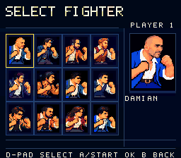
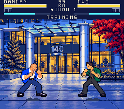
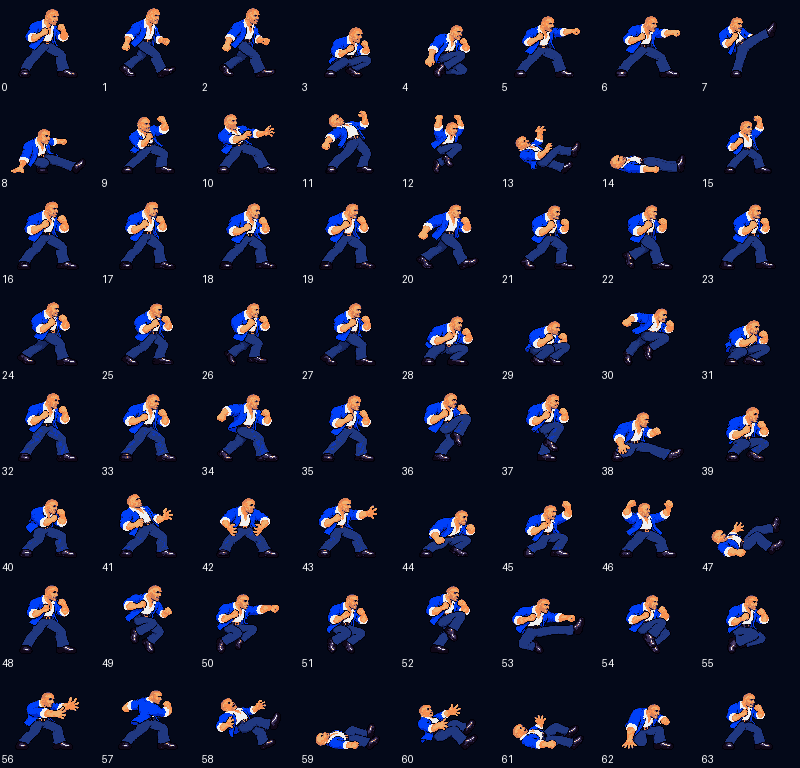

# Damian face revision v5

This is the v0.20.0 likeness review cartridge, ROM SHA256
`6b3544fa09e37a3f70c4eaecf5565718abc467962610ec1ce0437fc023d9f501`,
checksum `3F2A`. The full v0.19.0 release package remains the previous verified
release checkpoint. Extended release evidence and an offline ZIP have not
been regenerated for this review candidate.

The user reported that Damian's face still did not resemble him and supplied
an additional three-quarter photograph. The revision replaces the broad grin
and smooth generic face with a longer nose, dark brows, a narrower mouth and
short stubble, using that photograph as the identity reference. The blue suit,
white shirt and the existing pose roles remain the character's game costume.

All four source atlases were edited with the built-in imagegen tool. Their
exact prompts, reference hashes and unmodified generated output hashes are
retained in the versioned source provenance:

- [Legacy atlas](../assets/art/characters/00-damian/atlas-v5.png)
- [Motion atlas](../assets/art/characters/00-damian/animation-motion-v5.png)
- [Action atlas](../assets/art/characters/00-damian/animation-actions-v5.png)
- [Airborne atlas](../assets/art/characters/00-damian/animation-airborne-v5.png)
- [Legacy and portrait source](../assets/art/characters/00-damian/likeness-v5.json)
- [Motion and action sources](../assets/art/characters/00-damian/animation-v5.json)
- [Airborne, throw and knockdown source](../assets/art/characters/00-damian/animation-airborne-v5.json)
- [Current native contract](../assets/art/characters/00-damian/native-revision.json)
- [Historical v4 contract](../assets/art/characters/00-damian/native-revision-v4.json)

The original photo stays in the source reference folder; the cartridge uses
the illustrated art. All older Damian masters remain available. The source
loader selects v5 only for Damian through an exact contract pin; Lars and
Reston retain their existing v4 pins.

The [technical preservation record](damian-v5-report.json) compares generated
files and native RAM symbols with committed v0.19.0. It records 200 of 219
generated files preserved, 19 intentional Damian/selection/metadata changes,
all eleven other fighter records unchanged and all 1,276 RAM addresses
unchanged. Damian's fifteen-color OBJ palette, shared physical scale,
96x80 canvas and feet baseline 78 remain fixed. The C/assembly implementation
is unchanged except for the software version literal.

Agent review covered all 64 palette-converted frames and the two portrait
sizes. The portrait and combat scene were also captured from the native
Snes9x video callback. After viewing the photo, previous face, revised face and
native captures, the user answered "ok good" to "Does the revised face look
closer to Damian?" on 2026-10-22. This accepts the revised likeness for
integration. The exact response is retained in [review-feedback.json](review-feedback.json).
Team/subject consent and the other existing human release gates remain open.

Native suite and independent compatibility results are recorded against the
exact cartridge hash in the normal QA JSON files. See the final verification
section below for the completed run, rather than older release reports.

## Verification

`Test.cmd` exits 0 with all six reports on the exact ROM above: 2,596 gameplay,
18,084 roster, 3,344 presentation, 1,521 input, 8,163 stage and 2,007 Training
checks, totaling 35,715. The separate pinned bsnes2014 Accuracy compatibility
smoke also passes on that hash. The 20 authoring guard tests pass normally and
under Python `-O`, including wrong-version source/provenance rejection.
After canonicalizing source provenance line endings, `Build.cmd --assets`
reproduces the same cartridge. No GUI window or audio playback was used.

The [comparison page](DAMIAN-REVIEW-v5.html) presents the supplied photo,
previous and revised faces, both native portraits, native selection/combat
captures and the 64-frame sheet. The [verification record](damian-v5-verification.json)
binds these focused results to this review cartridge. Full release-scale
matrix, endurance, audio and fresh-export reports in the repository still
describe their original candidates; this is a likeness review build.

## Follow-up motion review

The user confirmed that they had stopped playing and cleared the foreground
focus restriction. The Computer Use desktop service returned a native-pipe
connection error, so no GUI emulator review was performed and no audio was
played. The [motion review record](damian-v5-motion-review.json) verifies nine
existing current-ROM GIFs against the committed captures and roster report.
They contain 316 decoded frames; agent review of 36 sampled stills found no
obvious clipped heads, missing faces, wrong facing or empty actor poses.
Continuous real-time GUI playback remains unassessed.

The [silent motion page](DAMIAN-MOTION-v5.html) shows the native air-kick and
throw captures from both sides, with a pause control. The
[sampled filmstrip](screenshots/damian-v5/motion-filmstrip.png) also includes
idle, walking and ordinary attack captures. These are capture-review artifacts;
the ROM, its source freeze and native suite results are unchanged.
